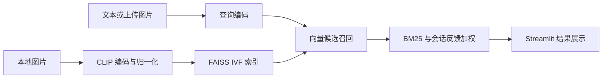

# 系统设计

## 数据流

## 模块职责

- `scripts/build_index.py`：按文件名排序遍历图片，编码后训练 IVF 索引。写入 `data/index/vector.index` 与使用仓库相对路径的 `paths.txt`。
- `app.py`：缓存模型与索引，召回最多 20 个候选，重排后展示前 6 个结果。
- `scripts/evaluate.py`：用内置查询与相关图片文件名列表计算离线指标。

## 排序与边界

页面对文本查询使用 `CLIP 分数 + 0.3 × BM25 分数 + 0.1 × 反馈值`。BM25 语料来自图片文件名，反馈值为 +1 或 -1；图片查询不叠加 BM25。查询扩展仅影响文本向量。

图片描述在构建时仅用于打印处理信息，不参与图片向量编码；离线评估优先用描述构造 BM25 语料。两条路径的区别见[评估说明](evaluation.md)。

构建脚本会将聚类数限制为图片数量以内，查询时忽略 FAISS 返回的无效候选 ID。小型图库仍可能出现 FAISS 聚类样本不足的提示；索引类型、融合权重与提示词均尚未通过独立验证集调优。
